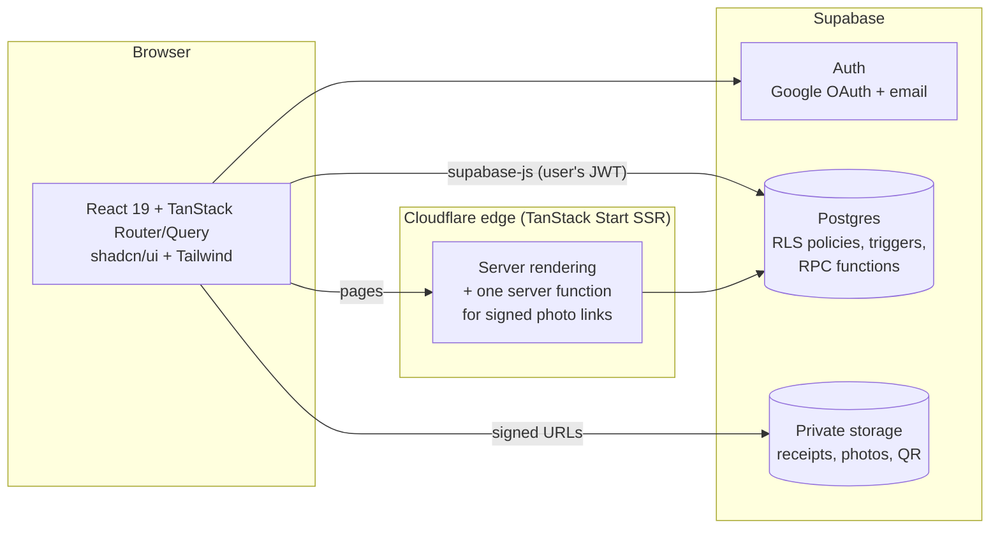
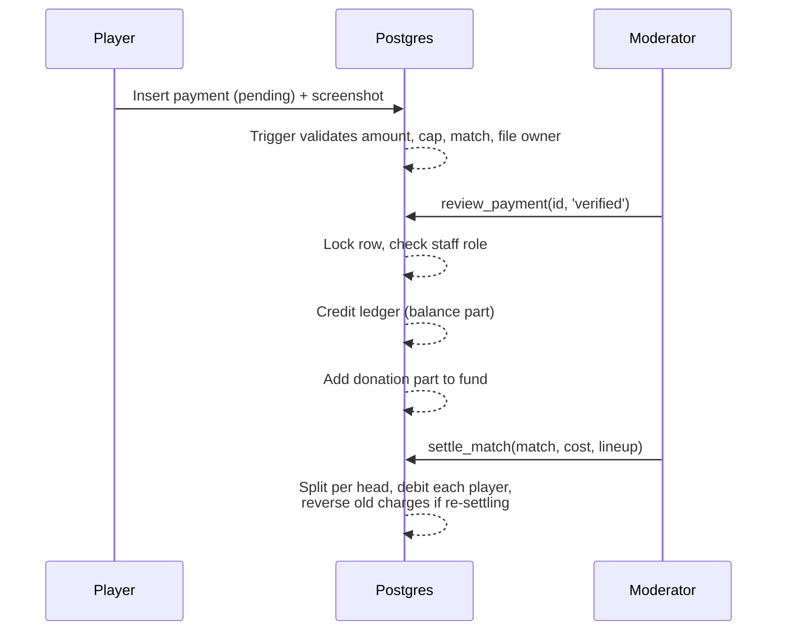

# Wednesday United

**A full-stack web app that runs a weekly after-office football club: matches, player sign-ups, team sheets, payments, balances and fundraising.**

**Live:** [wednesdayunited.me](https://wednesdayunited.me) · also at [wednesdayunited.lovable.app](https://wednesdayunited.lovable.app)

| | |
| --- | --- |
| **Role** | Product owner, designer and developer (sole builder) |
| **Timeline** | October 2026 – present (first release in under three weeks; 190+ commits) |
| **Stack** | React 19, TypeScript, TanStack Start/Router/Query, Supabase (Postgres, Auth, Storage), Tailwind CSS v4, shadcn/ui, Vitest |
| **Hosting** | Lovable Cloud on a Cloudflare edge runtime, custom domain on Namecheap DNS |
| **Users** | A real squad of colleagues who play every Wednesday, plus moderators who run the money |

---

## Contents

1. [The problem](#the-problem)
2. [What the app does](#what-the-app-does)
3. [Architecture](#architecture)
4. [Data model](#data-model)
5. [Money: payments, ledger and funds](#money-payments-ledger-and-funds)
6. [Security](#security)
7. [Engineering highlights](#engineering-highlights)
8. [Testing](#testing)
9. [Deployment and operations](#deployment-and-operations)
10. [Project structure](#project-structure)
11. [Running locally](#running-locally)
12. [What I learned](#what-i-learned)

---

## The problem

A group of colleagues plays football every Wednesday night. Organising it ran through chat messages and memory:

- Who's playing this week, and how many guests are they bringing?
- The pitch costs money. Who has paid, who still owes, and how much is each person's share?
- Some people pay in advance, some pay by bank transfer, some hand over cash at the pitch.
- The club wanted to raise money for shared things like a new match ball.

Wednesday United replaces that with one app. Players join a match in one tap, pay with a bank transfer or QR code and upload a screenshot, and always see their balance. Moderators verify payments, record cash, settle each match's cost per head, and track fundraising.

## What the app does

### For players
- **Browse and join matches.** Public match pages show date, venue (with an embedded map and directions), price and who's playing. Join or leave with up to five guests (the cap is configurable per match), until the registration deadline.
- **Sign in with Google or email.** Every new account waits for a moderator's approval before its first match.
- **Pay from anywhere.** A pop-up payment form on match pages, the home page and the payments page. Choose a purpose (a match, a balance top-up or a donation), enter the transaction ID and attach a screenshot. Bank details or a payment QR code are shown, depending on what the club uses.
- **Add a donation on top of a payment** in the same transfer. It's split automatically when verified.
- **See your balance.** A running balance (negative means you owe), every charge and credit, and what's still due per match.
- **Profile.** Photo upload (JPEG, PNG or WebP up to 300 KB), preferred position (GK, DEF, MID, FWD or anywhere), and a "My games" dashboard.
- **In-app notifications** for account approvals, newly published matches and payment updates.

### For moderators
- **Run matches.** Create, edit, publish, cancel and delete matches; manage venues; add players to a team sheet manually.
- **Settle a match.** Enter the total pitch cost and who actually played. The app splits it per head (guests included), charges each player and marks the match played. Settling again re-calculates and logs reversals of the old charges, so history is never lost.
- **Verify payments.** Review screenshots (opened through short-lived private links), then approve or reject with a reason. Approval credits the player's balance and the fund in one step.
- **Record cash.** Log cash handed over at the pitch, either toward a player's balance or as a donation to a fund.
- **See all balances.** Who owes what, biggest debts first, and a searchable log of every transaction.
- **Approve players** and **add members who haven't signed up yet** (placeholder players), then merge them into their real account when they join.
- **Payment details.** Choose whether players see bank details or a payment QR code, and keep them up to date.
- **Fundraising.** Create several donation goals with targets; the home page shows live progress, recent donors and a suggested share per player.

### For super admins
- Everything moderators can do, plus promoting players to moderator and demoting them.

## Architecture



### Key design decision: the database is the security boundary

Almost all data access goes from the browser straight to Postgres through the Supabase client, using the signed-in user's token. There's no custom API layer to keep in sync with the UI. Instead, **every rule is enforced inside the database**:

- **Row-level security (RLS)** decides which rows each user can read or write: players see their own payments, staff see everyone's, anonymous visitors see only published matches.
- **Triggers** validate data that users submit (for example, a payment must cover the player and their guests, must not exceed ৳2000, and the screenshot must sit in the player's own storage folder).
- **Security-definer functions (RPCs)** perform the privileged operations (verify a payment, settle a match, record cash, merge a placeholder player). Each checks the caller's role first and locks the rows it changes.

The React code only hides buttons the user can't use; it is never what stops them. That keeps the client simple and means a bug in the UI can't leak or corrupt data.

### Frontend
- **TanStack Start** for file-based routing and server-side rendering; signed-in areas render on the client only.
- **TanStack Query** with shared query definitions (`src/lib/matches.ts`, `payments.ts`, `ledger.ts`) reused across pages, so a single invalidation refreshes every view of the money.
- **Zod** validation on the client mirrors the database checks, so users get instant, friendly errors while the database still has the final say.
- A custom football-themed design system: pitch-line backgrounds, a scoreboard-style fund card, a ball that fills as the fund grows, count-up numbers and responsive tables that stack into cards on mobile.

## Data model

| Table / view | Purpose |
| --- | --- |
| `profiles` | One per person: name, email, photo, position, phone, approval status. Includes **placeholder** players with no login. Readable only by the owner and staff. |
| `player_directory` | A minimal public copy (name, photo) kept in sync by a trigger, so public pages never touch `profiles` (which holds emails). |
| `user_roles` | `player`, `moderator`, `super_admin`; checked in SQL with `has_role()` / `is_staff()`. |
| `matches`, `locations`, `registrations` | Matches with status (`draft`, `published`, `completed`, `cancelled`), venues, and who joined with how many guests. |
| `payments` | Submitted payments with purpose (`match`, `advance`, `donation`), amount, optional donation part, transaction ID, screenshot path and review status. |
| `ledger_entries` | **Append-only** money log: payments, match charges, charge reversals, adjustments. A balance is the sum. |
| `player_balances` (view) | Each player's balance and last activity. |
| `donation_goals` | Fundraising targets and amounts collected. |
| `notifications`, `audit_logs` | In-app messages; an automatic audit trail written by a database trigger. |

The schema evolved through **32 versioned SQL migrations** (`drizzle/migrations/`), each one small and reviewed, covering tables, policies, triggers, functions and storage rules.

## Money: payments, ledger and funds

Handling real people's money was the core of the project, so it gets the most care.



- **Append-only ledger.** Nothing is edited or deleted. Corrections are new entries (adjustments or reversals), so every balance can be traced back to its history.
- **Allocation.** A payment tagged to a match pays that match first, then the oldest debts. Players and staff can see exactly what's still due per match.
- **One transfer, two destinations.** A payment can carry a donation; on verification the balance part goes to the ledger and the donation part to the fund, atomically.
- **Cash at the pitch.** Moderators record cash toward a balance or as a fund donation. Cash donations are filed as already-verified payments through a staff-only function, so they appear in the donor's history and in the fund's activity like any other donation.
- **Limits and safety.** A ৳2000 cap per transfer, two-decimal amounts, a unique transaction ID per payment, and row locks so two moderators can't approve the same payment twice.

## Security

- **Row-level security on every table**, with policies written per role and per action.
- **Least-privilege public data:** anonymous visitors see only names and photos of players on published matches, served from a separate table that has no emails or phone numbers.
- **Private file storage:** payment screenshots and profile photos live in private buckets under per-user folders. They're read through signed links that expire in minutes, and screenshots attached to a payment can't be deleted.
- **Approval gate:** new accounts can't join matches or send payments until a moderator approves them.
- **Staff-only operations** (verifying, settling, cash, role changes, merges) run in database functions that check the caller's role and lock the rows they touch.
- **Audit trail** written by triggers, not by app code, so it can't be skipped.
- **Own Google OAuth client** with a verified domain, published privacy policy (`/privacy`) and terms (`/terms`).
- Several dedicated hardening passes reviewed and tightened the policies (for example: binding QR code reads to eligible callers, locking avatar reads, restricting who sees staff notifications).

## Engineering highlights

A few problems worth describing in more detail:

- **Re-settling a match without losing history.** Match costs sometimes change after the fact, or the team sheet was wrong. `settle_match` can run again on a played match: it writes reversal entries for the old charges and new charges for the corrected line-up, so balances are right *and* the history shows what changed.
- **Players who haven't signed up.** Some regulars never made an account. Staff can add them as placeholder profiles that work everywhere (team sheets, ledger, payments). When the person finally signs up, one function merges registrations, ledger entries, payments and notifications into the real account and removes the placeholder, combining guest counts if both were on the same team sheet.
- **Staff recording a payment on someone's behalf.** The payment table only accepts a player's own pending submissions. For cash donations, the staff-only function sets a transaction-local flag that, together with a staff caller and a verified donation row, lets exactly that insert through — without loosening the rule for anyone else.
- **Public pages without leaking emails.** Rather than joining the private `profiles` table, match pages read from `player_directory`, a minimal table kept in sync by a trigger and protected by its own policy.
- **Maps on a custom domain.** The managed Google Maps key only allowed the platform's own domains, so maps were blank on `wednesdayunited.me`. I switched venue maps to Google's keyless embed, which works on any domain with no API key or billing.
- **Branded sign-in.** Google sign-in initially showed the hosting platform's name. I set up the club's own OAuth client, verified domain ownership through a DNS TXT record in Google Search Console, and published the privacy policy and terms the consent screen requires.
- **Working within a managed platform.** The project syncs both ways with the Lovable editor, so I kept `main` always deployable, never rewrote pushed history, and wrote each database change as a new migration that the platform applies.

## Testing

- **68 automated tests in 13 files** with Vitest and jsdom (`src/test/`), covering payment validation and totals, the 2000 cap and donation split, ledger calls, match registration rules (deadlines, guest caps), approvals, deletion error handling, bank settings, QR handling, avatars, user management and routing.
- Business rules live in small pure modules (`*-rules.ts`) so they can be tested without a browser or database.
- TypeScript strict type checking on every change, using generated database types.
- Manual verification of each feature in the running app, including mobile layouts.

```sh
npm run test                          # all tests
npx vitest run src/test/ledger.test.ts  # one file
```

## Deployment and operations

- **Hosting:** Lovable Cloud builds the app (Vite + Nitro) and serves it from a Cloudflare edge runtime. Pushing to `main` syncs into the platform; publishing makes it live.
- **Database changes:** versioned SQL migrations in `drizzle/migrations/`, applied by the platform; database types are regenerated afterwards.
- **Domain:** `wednesdayunited.me` on Namecheap DNS, with A records for the site and TXT records for platform and Google verification.
- **Authentication:** Google OAuth with the club's own client (consent screen branding, authorized domains and redirect URIs), plus email and password.
- **Roadmap:** completed and pending work is tracked in [`roadmap.md`](roadmap.md).

## Project structure

```
src/
  routes/                 File-based pages (TanStack Router)
    index.tsx             Home: upcoming matches, balance, fund
    matches.$id.tsx       Public match page with team sheet and map
    history.tsx           Past matches
    privacy.tsx, terms.tsx
    _authenticated/       Signed-in pages: dashboard, payments, profile,
                          manage (matches & venues), users, player pages
  components/             UI: match cards, payment forms, fund card, dialogs
    ui/                   shadcn/ui primitives
  lib/                    Data access and business rules
    matches.ts            Match, venue and registration queries and rules
    payments.ts, payment-rules.ts   Payment queries, validation, totals
    ledger.ts             Balances, settlement, cash, donation goals
    users.ts, placeholder-rules.ts  User management and placeholders
    deletion.ts           Safe deletes with friendly errors
  integrations/supabase/  Generated client and database types
  test/                   Vitest suites
drizzle/migrations/       SQL migrations: schema, RLS, triggers, functions
roadmap.md                Feature tracking
```

## Running locally

Requires Node.js (or Bun) and access to the project's Supabase environment variables (`.env`).

```sh
npm install
npm run dev       # Vite dev server
npm run build     # production build
npm run test      # unit tests
npm run lint      # ESLint
```

The project is also editable in the [Lovable editor](https://lovable.dev/projects/77e27e71-fe5d-49bd-a248-1487c61d2a60); changes made there are committed to this repository.

## What I learned

- **Put the rules where the data is.** Enforcing permissions and money rules in Postgres (RLS, triggers, locked functions) made the app safer and the frontend much simpler.
- **Model money as an append-only ledger.** Reversals and adjustments instead of edits made disputes easy to answer: every balance has a full history.
- **Design for real users' habits.** Cash at the pitch, friends who never sign up, payments that mix a match fee with a donation — each became a first-class feature because that's how the club actually works.
- **Ship small, safe changes to production.** Small migrations, tests for the rules, and an always-deployable main branch let a live app with real money keep evolving week to week.
- **Build with AI tools while staying in charge of the design.** I used Lovable and Claude Code to move fast, while making the product, data-model and security decisions, reviewing every change and testing it against the real app.

---

Built by **Nasif Ishtiaque Islam**.
